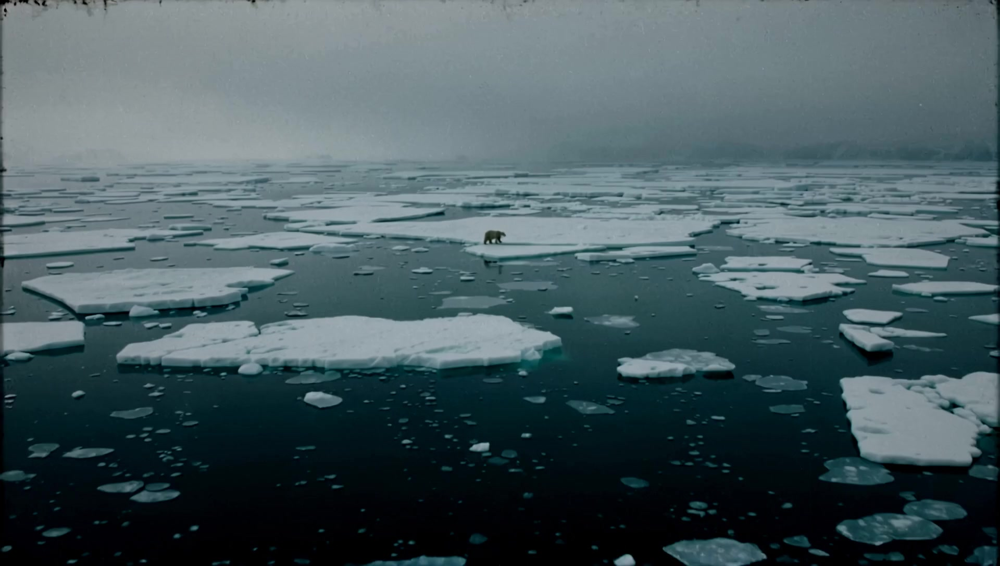
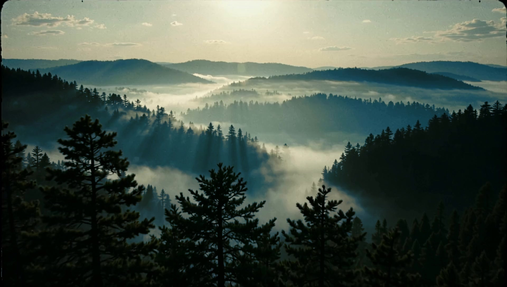
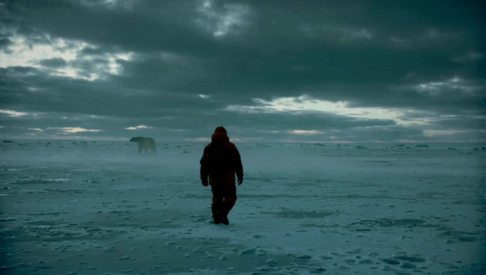

# AI 视频生产线

> **TL;DR (EN)** — A text-to-video production line measured end to end on a single GPU.
> Native 1080p, 5 s per clip: 200 s to generate at ¥0.44; 3.4 min and ¥0.45 with
> post. Audio is generated jointly with the picture rather than added afterwards.
> Quality control is numeric — sharpness, blocking, seams, noise, frozen frames — so
> clips get rejected before a human looks at them. Upscaling is not a substitute for
> native resolution: the detail it restores is invented.

> 版本：2026-11-25
> 环境：单卡云机，96 GB 显存，¥8/小时
> 一句话：一套能出原生 1080p、能做 3D、能自动质检的视频生产流水线。

---

## Showreel：20 秒 · 多镜头

[](assets/showreel_20s.mp4)

▶ [`assets/showreel_20s.mp4`](assets/showreel_20s.mp4) — 1920×1088 / 20.0 s / h264 / 带音轨

| 时间 | 镜头 |
|---|---|
| 0–5 s | 冰川峡湾，蓝色冰壁 |
| 5–10 s | 极地冰面，橙色外套的人走向远处，侧后方有北极熊 |
| 10–15 s | 针叶林山谷，日出穿雾 |
| 15–20 s | 浮冰海面俯拍，一小只北极熊站在冰上 |

**这条是剪辑拼起来的，不是单次生成。** 判据很简单：文件里没有 `prompt` 标签，而单次直出的 mp4 会把整张工作流图写进元数据（见下一节）。四个地理位置不同的场景也不可能出现在同一个 latent 里。

**音频由工作流生成，不是后期配的。** 但成片经过拼接和二次编码，逐镜的参数已经丢失，所以没法从成片反查每个镜头的 seed、步数和提示词。这正是下一节要单独留一条单镜头的理由。

### 这条证明什么，不证明什么

| 证明了 | 没证明 |
|---|---|
| 质感控制：统一青调 + 35mm 颗粒 + 暗角，四个场景不打架 | 单条长镜头的稳定性 |
| 构图：信息量集中、主体小、留白够 | 角色一致性（没有同一角色跨镜头） |
| 原生音画：每个镜头出画面时同时出音 | 有动作、对话、人脸的表现力 |




### 一次完整交付

[`deliverables/2026-11-25/`](deliverables/2026-11-25/) 是 2026-11-24 夜跑出来的一批：4 条成片、6 条 5 秒素材、11 张静帧，附成本与质检记录。

那份 README 里写清了每条的成本、耗时、瑕疵检测结果，以及哪些没做到。

---

## 单条直出：自带配方（待补）

一条单次生成的样片，mp4 的 `prompt` 标签里会带着完整的工作流图：模型、编码器、分辨率、帧数、采样步数、seed，以及音画是否共用同一个 latent。

看的人不需要相信任何说法，`ffprobe` 一次就能核对参数。这是区分「模型直出」和「剪辑拼出来的」最省事的办法。

> 当前状态：待补。等这一版单镜头跑完、元数据完整，会把样片、静帧和配方表一起放进来。

---

## 这条产线能做什么

| 能力 | 状态 | 指标 |
|---|---|---|
| 原生 1080p 视频 | 已验证 | 5 秒片 200 秒，¥0.44 |
| 576p + 4× 超分（对照路线） | 已验证 | 21 分钟 / 5 秒，¥3 |
| 图生 3D 网格（.glb） | 已验证 | 2.7 秒，约 200 万面 |
| 3D 渲染 | 已验证 | 1200×1500，约 2 分钟/视角 |
| 原生音画同步 | 已验证 | 5 秒片，48 kHz 立体声 |
| 自动质检 | 已实现 | 9 项瑕疵指标，带阈值 |
| 自动拼接与统一调色 | 已实现 | 约 40 秒 CPU |
| 分镜编排 | 已实现 | 分镜 JSON → 逐镜调度 → 重试 |
| 角色一致性 | 缺口 | 需训练专用适配器 |
| 口型同步 | 部分 | 模型已下载，未接入 |

---

## 三条实测出来的判断

### 1. 原生分辨率不能靠超分补

超分能提锐度，但细节是编的。看着"精细"，放大到 100% 就散了。
真正的高清必须在生成阶段就有。

### 2. 音频可以和画面一起出

在同一个 latent 里生成，不需要另配。成片里的风声是模型出的，不是素材库。

### 3. 人放小、背对镜头，可以绕开人脸

7 条素材里有 3 条带人物，全部没崩。正脸近景还没试，按现在的表现大概率不行。

---

## 仓库结构

```
README.md                  本文件
assets/                    showreel（20 秒成片 + 静帧）
deliverables/2026-11-25/   一次完整交付：成片、素材、静帧、成本与质检记录
LICENSE
```

---

## 最大的两个坑

1. **角色一致性**：必须训专用适配器，否则跨镜头会漂。
2. **单图重建的 3D 网格**：出来是碎片化的开口曲面，要重网格清理才能用。

---

## License

MIT - see [LICENSE](LICENSE).
